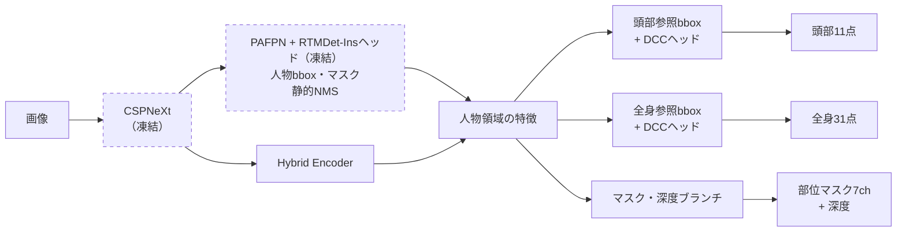

# RTMDet-Fusion

[English](README.md) | 日本語


<sub>s_640の推論結果です。（左上から全身・頭部キーポイント、部位マスク、深度。最下段は各人物の頭部3Dキーポイント）<br>元映像: [People Dancing Hip Hop](https://www.pexels.com/video/people-dancing-hip-hop-8688453/)（ANTONI SHKRABA production、Pexels License）</sub>

画像1枚から、写っている人物ごとに **bbox・インスタンスマスク・頭部と全身の3Dキーポイント・部位マスク・深度** をまとめて推定するワンステージモデルです。骨格とマスクを同時にリアルタイムで使う用途に向けて設計しており、一例として人物を基準（マーカーなど）にしたARアプリケーションに最適です。

[RTMDet-Ins](https://github.com/open-mmlab/mmdetection/tree/main/configs/rtmdet)をベースとし、ONNX/CoreML/TensorFlow.jsへの変換をサポートし、Webブラウザ・iOS/macOSにおいてリアルタイムな速度で動作させられます（AndroidはONNX Runtimeでの利用を想定していますが未検証です）。

> [!IMPORTANT]  
> **学習済みの重みと学習データは含まれていません。**  
> 使うには、[AGORA](https://agora.is.tue.mpg.de)と[SMPL-X](https://smpl-x.is.tue.mpg.de)のそれぞれのライセンスに同意して入手し、自前で学習データを生成してお手元のGPUで学習させる必要があります。  
> AGORA/SMPL-Xは非商用に限られるため、それらで学習したモデルも同じ制約を受けます（[ライセンス](#ライセンス)をご確認ください）。

## 特徴

- **1回の推論で人物ごとに次を出力します**:
  - bbox（人物の検出bboxと、頭部・全身の参照bbox。参照bboxは画面外へもはみ出せます）
  - 人物マスク
    - RTMDet-Ins由来のインスタンスマスク（見えている領域、ピクセル毎に0〜1の値）
    - 部位マスク7ch（着衣を含む全身・素体・頭部・胴体・四肢・手は隠れた部分も含むamodal、残る1chはそのうち遮蔽されている領域）
    - 深度マップ（骨盤を基準とした人物表面の相対的な奥行き。隠れた部分も含む全身の領域で有効）
  - 3Dキーポイント（点ごとに画面内にあるか・遮蔽されていないかの確率つき。奥行きは基準点からの相対値）
    - 頭部11点の独自3Dキーポイント
    - 全身31点の3Dキーポイント（先頭17点はCOCOと互換性あり）
  - 頭部bbox内の中間特徴量（見た目・姿勢）をそのまま出力（Re-IDの実験用の試験的実装。識別用の学習はしておらず、そのままでは精度は限定的です）
- **軽量・リアルタイム**:
  - モデルはtiny/sの2バリアント、入力解像度は256,320,416,512,640の各ピクセル四方に対応（マルチスケール学習）
  - 処理速度参考: Apple M4 MaxのCoreML（CPU+GPU、NMS込み）でs_640が約13ms・tiny_256が約6ms
- **出力形状が固定**:
  - テンソル出力はONNX・CoreML・TensorFlow.jsのすべてで同じ19本（ただしCoreMLは出力名に`out_`が付き、TensorFlow系は入力と部位マスクがチャネル最後の並びになります。TFLiteは変換の副産物で未検証です）
  - 人物スロットは固定5枠（CoreMLは書き出し時に変更可）とし動的な形状を排除。検出が規定数に満たない枠はキーポイント座標以外が0になります（有効数は`valid_count`で判定）

## 構成

COCO学習済みのRTMDet-Insを凍結して人物検出とマスクに使い、バックボーンから分岐した学習可能なヘッド群で
キーポイント・部位マスク・深度を推定します（詳細は[docs/architecture.md](docs/architecture.md)）。



## 使い方

| 手順 | 内容 | 文書 |
|---|---|---|
| 1. 環境構築 | uv・PyTorch（CUDA）・MMDetection・mmcv、RTMDet-Insの事前学習重み | [docs/setup.md](docs/setup.md) |
| 2. データ準備 | AGORAとSMPL-Xから学習データ（クロップ画像・アノテーション・教師マップ）を生成 | [docs/data-preparation.md](docs/data-preparation.md) |
| 3. 学習 | 2段階（キーポイント → マスク・深度）。tiny / sを同時に学習 | [docs/training.md](docs/training.md) |
| 4. 書き出し | ONNX・CoreML・TensorFlow.js | [docs/export.md](docs/export.md) |
| 5. 組み込み | 入出力の仕様 | [docs/output-contract.md](docs/output-contract.md) |

動作を確認している環境は、学習がWindows 11 + RTX 5070 Ti（CUDA 12.8）、書き出しがmacOS（Apple Silicon）です。

### 推論例（ONNX Runtime）

```python
import cv2
import onnxruntime as ort

sess = ort.InferenceSession('onnx_models/rtmdet_fusion_s_640_v2.0.0.onnx')
image = cv2.imread('image.jpg')                                   # BGR のまま使う
h, w = image.shape[:2]
x = cv2.resize(image, (640, 640)).transpose(2, 0, 1)[None].astype('float32')   # 縦横比は保たない
out = dict(zip([o.name for o in sess.get_outputs()], sess.run(None, {'images': x})))

for i in range(int(out['valid_count'][0])):
    if out['scores'][i] < 0.3:                                    # 足切りはアプリ側で決める
        continue
    x1, y1, x2, y2 = out['body_bboxes'][i]                        # 全身の参照 bbox（640×640 空間）
    rel = out['body_keypoints'][i]                                # (31, 3) [rel_x, rel_y, rel_z]
    px = (rel[:, 0] * (x2 - x1) + x1) * w / 640                   # 元画像の座標へ
    py = ((1 - rel[:, 2]) * (y2 - y1) + y1) * h / 640
    in_frame = out['body_in_frame'][i] >= 0.5                     # 画面外の点は False
```

ブラウザで試すには[examples/web-bench](examples/web-bench/README.md)（TensorFlow.js / ONNX Runtime Web）を使ってください。

## バージョン

版はgit tag（SemVer）で管理し、チェックポイントと書き出した成果物（ファイル名・メタデータ）に自動で埋め込みます。  
現在の版は**v2.0.0**です。出力の名前・並び・意味が変わる変更はMAJORとして扱います。

## ディレクトリ構成

```
configs/default.py        定数（キーポイント定義・RTMDet-Ins 設定・パス）
rtmdet_fusion/            モデル・損失・データセット・ユーティリティ
tools/agora/              AGORA からの学習データ生成
tools/train.py            学習
tools/viewer.py           推論ビューア（PyQt5）
tools/onnx_exporter.py    ONNX 書き出し
tools/coreml_exporter_native.py  CoreML 書き出し（macOS）
tools/tf-converter/       ONNX → TensorFlow SavedModel / TFLite
tools/tfjs-converter/     SavedModel → TensorFlow.js
examples/web-bench/       ブラウザでの動作確認アプリ
scripts/mmcv-build/       Windows + Blackwell GPU 向けの mmcv ビルド
docs/                     設計・手順の文書（日本語）
```

## ライセンス

本リポジトリのコードは[Apache License 2.0](LICENSE)です。  
派生元と同梱物の表記は[NOTICE](NOTICE)にあります。

- [AGORA](https://agora.is.tue.mpg.de/license.html)と[SMPL-X](https://smpl-x.is.tue.mpg.de/modellicense.html)の利用は非商用の研究・教育・芸術目的に限られ、再配布は禁止されています。商用目的のモデルの学習にも使えません。  
  これらから生成した学習データ、およびそれを用いて学習したモデルも各ライセンスに従ってください。また、成果を発表する場合には指定された引用の表示が必要です。
- RTMDet-Insの事前学習重みはOpenMMLabが配布しているもので、本リポジトリには含まれていません（入手方法は[docs/setup.md](docs/setup.md)）。

## 参考文献

モデルの設計は主に以下に基づいています。

- [RTMDet](https://arxiv.org/abs/2212.07784): ベースの検出・インスタンスセグメンテーション
- [RTMPose](https://arxiv.org/abs/2303.07399): SimCC方式の姿勢推定
- [RTMO](https://arxiv.org/abs/2312.07526)（[HTML版](https://arxiv.org/html/2312.07526v2)）: DCC方式のone-stage姿勢推定（CVPR 2024）
- [RTMW](https://arxiv.org/abs/2407.08634): 2D/3D全身姿勢推定（RTMW3Dの統一座標と3D損失）
- [SimCC](https://arxiv.org/abs/2107.03332): 座標分類方式（ECCV 2022）
- [DETR](https://arxiv.org/abs/2005.12872): L1+GIoU損失の比率
- [DAB-DETR](https://arxiv.org/abs/2201.12329): Dynamic Anchor Boxes（ICLR 2022）
- [GIoU](https://giou.stanford.edu/GIoU.pdf): Generalized IoU損失
- [RT-DETR](https://arxiv.org/abs/2304.08069): Hybrid Encoder
- [AGORA](https://arxiv.org/abs/2104.14643): 学習データ（CVPR 2021）
- [SMPL-X](https://arxiv.org/abs/1904.05866): 人体モデル（CVPR 2019）

実装の参考: [MMDetection](https://github.com/open-mmlab/mmdetection)、
[MMPose RTMO](https://github.com/open-mmlab/mmpose/tree/main/projects/rtmo)、
[MMPose RTMPose3D](https://github.com/open-mmlab/mmpose/tree/main/projects/rtmpose3d)、
[rtmlib](https://github.com/Tau-J/rtmlib)、[agora_evaluation](https://github.com/pixelite1201/agora_evaluation)
