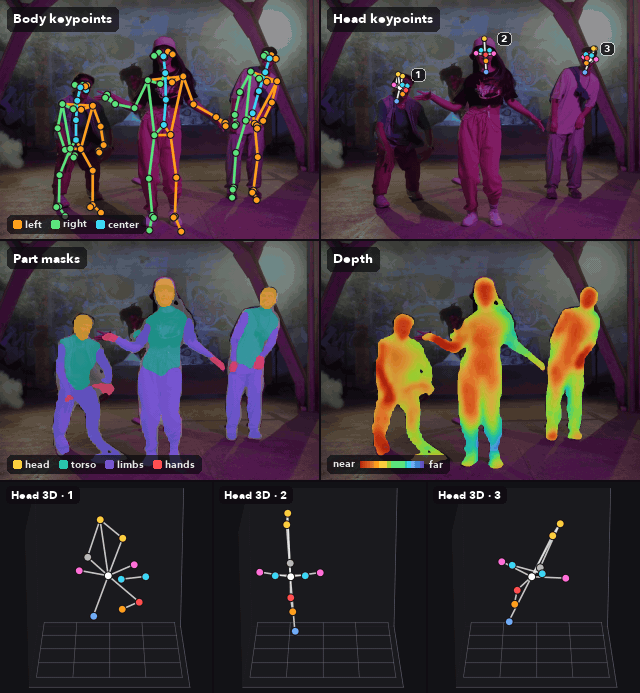
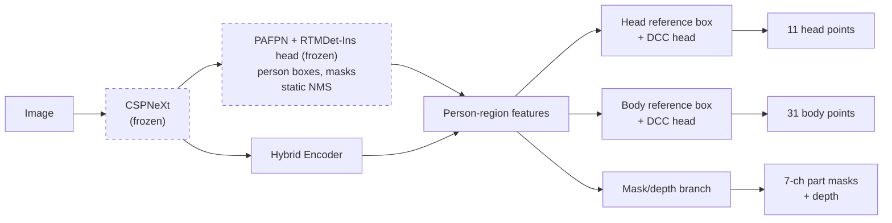

# RTMDet-Fusion

English | [日本語](README.ja.md)



<sub>Output of s_640 (from top left: body keypoints, head keypoints, part masks, depth; bottom row: 3D head keypoints of each person).<br>Source footage: [People Dancing Hip Hop](https://www.pexels.com/video/people-dancing-hip-hop-8688453/) by ANTONI SHKRABA production (Pexels License)</sub>

A one-stage model that estimates **bounding boxes, instance masks, 3D head and whole-body keypoints, part masks and
depth** for every person in an image, all at once. It is designed for use cases that need skeletons and masks together
in real time — for example, AR applications that use people as anchors (markers).

Built on [RTMDet-Ins](https://github.com/open-mmlab/mmdetection/tree/main/configs/rtmdet), it can be exported to ONNX,
CoreML and TensorFlow.js and runs at real-time speed in web browsers and on iOS / macOS (Android via ONNX Runtime is
intended but not yet tested).

> [!IMPORTANT]  
> **Trained weights and training data are not included.**  
> To use the model, obtain [AGORA](https://agora.is.tue.mpg.de) and [SMPL-X](https://smpl-x.is.tue.mpg.de) under
> their respective licenses, generate the training data yourself and train on your own GPU.  
> AGORA and SMPL-X are limited to non-commercial use, and models trained on them are subject to the same restriction
> (see [License](#license)).

## Features

- **Per person, in a single inference**:
  - Bounding boxes (the person detection box, plus head and body reference boxes that may extend outside the image)
  - Person masks
    - Instance mask from RTMDet-Ins (visible region, a 0–1 value per pixel)
    - 7-channel part masks (clothed body, bare body, head, torso, limbs and hands, all amodal, i.e. including
      hidden parts; the last channel is the occluded portion)
    - Depth map (relative depth of the body surface from the pelvis, valid over the whole body including hidden parts)
  - 3D keypoints (with per-point probabilities of being inside the image and of being unoccluded; depth is relative to a
    reference point)
    - 11 custom head keypoints
    - 31 whole-body keypoints (the first 17 are compatible with COCO)
  - Intermediate features from the head box (appearance and pose), output as-is (experimental, for Re-ID experiments;
    not trained for identification, so their accuracy is limited)
- **Lightweight and real-time**:
  - Two variants (tiny / s); input sizes 256, 320, 416, 512 and 640 pixels square (multi-scale training)
  - Speed reference: about 13 ms for s_640 and 6 ms for tiny_256 with CoreML (CPU + GPU, NMS included) on an Apple M4 Max
- **Fixed output shapes**:
  - The same 19 output tensors in ONNX, CoreML and TensorFlow.js (CoreML output names carry an `out_` prefix, and the
    TensorFlow formats use channels-last for the input and part masks; TFLite is a by-product of the conversion and has
    not been tested)
  - A fixed number of person slots (5; configurable for CoreML at export time) with no dynamic shapes. Slots beyond the
    detections are zero except for the keypoint coordinates (use `valid_count` for the number of valid slots)

## Architecture

RTMDet-Ins, pretrained on COCO, is frozen and used for person detection and masks; trainable heads that branch off the
backbone estimate keypoints, part masks and depth (details: [docs/architecture.md](docs/architecture.md), Japanese).



## Usage

The documents under `docs/` are written in Japanese.

| Step | Content | Document |
|---|---|---|
| 1. Setup | uv, PyTorch (CUDA), MMDetection, mmcv, RTMDet-Ins pretrained weights | [docs/setup.md](docs/setup.md) |
| 2. Data preparation | Generate training data (crops, annotations, teacher maps) from AGORA and SMPL-X | [docs/data-preparation.md](docs/data-preparation.md) |
| 3. Training | Two stages (keypoints → masks and depth); tiny and s are trained together | [docs/training.md](docs/training.md) |
| 4. Export | ONNX, CoreML, TensorFlow.js | [docs/export.md](docs/export.md) |
| 5. Integration | Input/output specification | [docs/output-contract.md](docs/output-contract.md) |

Tested environments: training on Windows 11 + RTX 5070 Ti (CUDA 12.8); export on macOS (Apple Silicon).

### Inference example (ONNX Runtime)

```python
import cv2
import onnxruntime as ort

sess = ort.InferenceSession('onnx_models/rtmdet_fusion_s_640_v2.0.0.onnx')
image = cv2.imread('image.jpg')                                   # keep BGR
h, w = image.shape[:2]
x = cv2.resize(image, (640, 640)).transpose(2, 0, 1)[None].astype('float32')   # aspect ratio is not kept
out = dict(zip([o.name for o in sess.get_outputs()], sess.run(None, {'images': x})))

for i in range(int(out['valid_count'][0])):
    if out['scores'][i] < 0.3:                                    # choose the threshold in your application
        continue
    x1, y1, x2, y2 = out['body_bboxes'][i]                        # body reference box (640x640 space)
    rel = out['body_keypoints'][i]                                # (31, 3) [rel_x, rel_y, rel_z]
    px = (rel[:, 0] * (x2 - x1) + x1) * w / 640                   # back to original image coordinates
    py = ((1 - rel[:, 2]) * (y2 - y1) + y1) * h / 640
    in_frame = out['body_in_frame'][i] >= 0.5                     # False for points outside the image
```

To try it in a browser, use [examples/web-bench](examples/web-bench/README.md) (TensorFlow.js / ONNX Runtime Web).

## Versioning

Versions are managed with git tags (SemVer) and embedded automatically in checkpoints and exported artifacts (file
names and metadata).  
The current version is **v2.0.0**. Changes to output names, order or meaning are treated as MAJOR.

## Repository layout

```
configs/default.py        constants (keypoint definitions, RTMDet-Ins configs, paths)
rtmdet_fusion/            model, losses, dataset, utilities
tools/agora/              training data generation from AGORA
tools/train.py            training
tools/viewer.py           inference viewer (PyQt5)
tools/onnx_exporter.py    ONNX export
tools/coreml_exporter_native.py  CoreML export (macOS)
tools/tf-converter/       ONNX → TensorFlow SavedModel / TFLite
tools/tfjs-converter/     SavedModel → TensorFlow.js
examples/web-bench/       browser test app
scripts/mmcv-build/       mmcv build for Windows + Blackwell GPUs
docs/                     design and procedure documents (Japanese)
```

## License

The code in this repository is licensed under the [Apache License 2.0](LICENSE).  
Attributions for derived works and bundled files are in [NOTICE](NOTICE).

- [AGORA](https://agora.is.tue.mpg.de/license.html) and [SMPL-X](https://smpl-x.is.tue.mpg.de/modellicense.html) may be
  used only for non-commercial research, education and artistic purposes, must not be redistributed, and must not be
  used to train models for commercial purposes.  
  Training data generated from them, and models trained on that data, are subject to their licenses. Publications must
  include the citations they require.
- The RTMDet-Ins pretrained weights are distributed by OpenMMLab and are not included in this repository (see
  [docs/setup.md](docs/setup.md)).

## References

The design is mainly based on:

- [RTMDet](https://arxiv.org/abs/2212.07784): base detector and instance segmentation
- [RTMPose](https://arxiv.org/abs/2303.07399): SimCC-based pose estimation
- [RTMO](https://arxiv.org/abs/2312.07526) ([HTML](https://arxiv.org/html/2312.07526v2)): one-stage pose estimation with DCC (CVPR 2024)
- [RTMW](https://arxiv.org/abs/2407.08634): 2D/3D whole-body pose estimation (unified coordinates and 3D losses of RTMW3D)
- [SimCC](https://arxiv.org/abs/2107.03332): coordinate classification (ECCV 2022)
- [DETR](https://arxiv.org/abs/2005.12872): ratio of L1 and GIoU losses
- [DAB-DETR](https://arxiv.org/abs/2201.12329): Dynamic Anchor Boxes (ICLR 2022)
- [GIoU](https://giou.stanford.edu/GIoU.pdf): Generalized IoU loss
- [RT-DETR](https://arxiv.org/abs/2304.08069): Hybrid Encoder
- [AGORA](https://arxiv.org/abs/2104.14643): training data (CVPR 2021)
- [SMPL-X](https://arxiv.org/abs/1904.05866): body model (CVPR 2019)

Implementation references: [MMDetection](https://github.com/open-mmlab/mmdetection),
[MMPose RTMO](https://github.com/open-mmlab/mmpose/tree/main/projects/rtmo),
[MMPose RTMPose3D](https://github.com/open-mmlab/mmpose/tree/main/projects/rtmpose3d),
[rtmlib](https://github.com/Tau-J/rtmlib), [agora_evaluation](https://github.com/pixelite1201/agora_evaluation)
