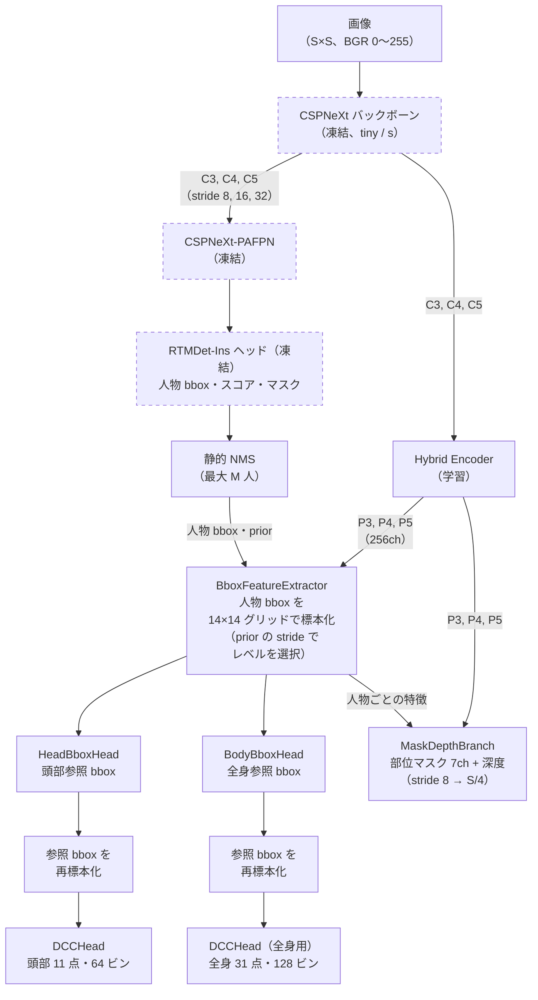
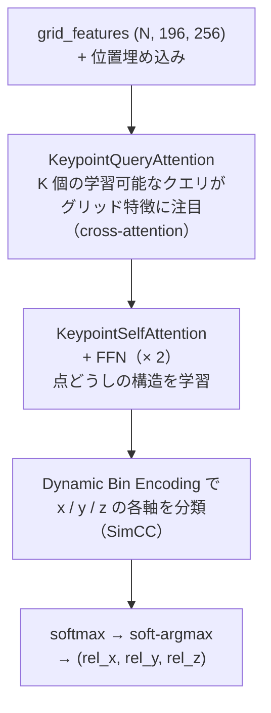

# モデル構造

RTMDet-Fusionは、COCOで学習済みのRTMDet-Ins（人物検出・インスタンスマスク）を凍結したまま使い、
その上に頭部・全身キーポイント、部位マスク、深度を推定する学習可能なヘッド群を載せたワンステージモデルです。

## 1. 全体構造

学習するのはHybrid Encoder・BboxFeatureExtractor・HeadBboxHead・DCCHead・BodyBboxHead（全身用DCCHead
含む）・MaskDepthBranchのみです。RTMDet-Ins（バックボーン・PAFPN・ヘッド）はCOCO重みのまま凍結します。

### RTMDet-Insバリアント

| バリアント | deepen_factor | widen_factor | 出力チャネル（C3） | 事前学習重み |
|---|---|---|---|---|
| tiny | 0.167 | 0.375 | 96 | `weights/rtmdet-ins_tiny.pth` |
| s | 0.33 | 0.5 | 128 | `weights/rtmdet-ins_s.pth` |

viewer・エクスポータはチェックポイントの`hybrid_encoder_state_dict['input_proj.0.0.weight']`の形状
（`[256, 96, 1, 1]` = tiny、`[256, 128, 1, 1]` = s）からバリアントを自動判定します。

## 2. 各モジュール

### Hybrid Encoder（`rtmdet_fusion/models/encoders/`）

RT-DETR / RTMOと同じFPN + PAN構成です。C3〜C5を1×1 convで256chに揃え、トップダウン（FPN）と
ボトムアップ（PAN）のCSPRep層（RepVGGブロック）でP3〜P5を作ります。凍結されたPAFPNとは独立に
キーポイント向けの特徴を学習します。

### BboxFeatureExtractor

bbox領域を14×14 = 196点のグリッドで双線形補間して標本化し、256次元に射影します。2Dのsine位置埋め込みを付けます。
どのFPNレベルから取るかは検出のpriorのstrideで決め、one-hotの重み付き和で選びます（gatherを使いません）。
書き出し時は`F.grid_sample`の代わりに、同じ値を行列積で求める`separable_bilinear_sample`を使います（[export.md](export.md)）。

### HeadBboxHead / BodyBboxHead

人物bboxのグリッド特徴を平均してMLPで回帰し、参照bboxを出します。人物bboxの中心から
± `range_scale` / 2 × 人物bboxサイズの範囲をsigmoidで表すので、参照bboxは人物bboxや画像の外にはみ出せます
（頭部1.25倍、全身2.0倍）。

### DCCHead（キーポイント）

RTMOのDynamic Coordinate Classifierに倣ったヘッドです。

- 出力は参照bboxに対する統一座標(rel_x, rel_y, rel_z)です。rel_yは奥行きで、基準点（頭部はcenter、
  全身はpelvis）が0.5です（[output-contract.md](output-contract.md) §3）
- ビンの範囲は[-0.125, 1.125]（マージンビン）で、参照bboxをわずかに超える点・画面外の点も表せます
- 信頼度はビン分布のエントロピーから求め、一様分布で0、σ = 0.025のガウシアンで1になるよう正規化します（推論時の設定。学習ターゲットはσ = 0.03なので、これを完全に再現した点は約0.93になります）
- visibility（遮蔽されていないか）とin_frame（画面内か）を別々の2値ヘッドで出します
- 頭部は11点・64ビン、全身は31点・128ビンです

### MaskDepthBranch（部位マスク・深度）

Hybrid EncoderのP3〜P5をstride 8に融合して8chのプロトタイプ特徴を作り、人物ごとの特徴量から生成した
カーネルでdynamic convolution（RTMDet-Insのマスクヘッドと同じbmm方式）を行います。出力はマスク7chと深度1chです。
書き出し時に入力解像度の1/4へアップサンプルします。

### 頭部姿勢・特徴量

- `head_quaternions`: 頭部キーポイント（center・top・nose）から幾何計算で求めます（学習パラメータなし）
- `appearance_features`: 頭部参照bboxのグリッド特徴の平均、`pose_features`: 頭部キーポイント特徴の平均。
  いずれも識別用の学習はしていません

## 3. 推論時の流れ

1. RTMDet-Insで人物を検出し、テンソル演算だけの静的NMSで最大M人を選びます（スコアの足切りは書き出し時に設定）
2. 人物bboxのグリッド特徴から頭部・全身の参照bboxを予測します
3. 参照bboxを再標本化してDCCHeadでキーポイントを推定します
4. マスク・深度ブランチで部位マスクと深度を出します
5. 固定M枠の出力にまとめます（`valid_count` = 有効数）

## 4. 主な設計判断

| 判断 | 理由 |
|---|---|
| RTMDet-Insを凍結して流用 | COCOで学習済みの人物検出・マスクをそのまま使い、学習対象をキーポイント等に絞る |
| Hybrid Encoderをバックボーンから分岐 | 凍結したPAFPNとは独立に、キーポイント向けの特徴を学習できる |
| 参照bboxを学習で予測 | 人物bboxからの経験則より正確で、画面外へはみ出す頭部・全身も扱える |
| RoI Alignを使わない | Webランタイムでの対応が弱いため、grid標本化（書き出し時は行列積）で代替 |
| 2D/3Dを分けない統一座標（RTMW3D方式） | 単一の3軸分類で学習でき、2D/3Dの損失バランス調整が要らない |
| ワンステージ（RTMO方式） | トップダウンの2段構成より書き出し時の互換性が高い |
| 固定スロット出力・静的NMS | 動的形状や`NonMaxSuppression` opを使わず、全ランタイムで同じグラフを動かせる |
